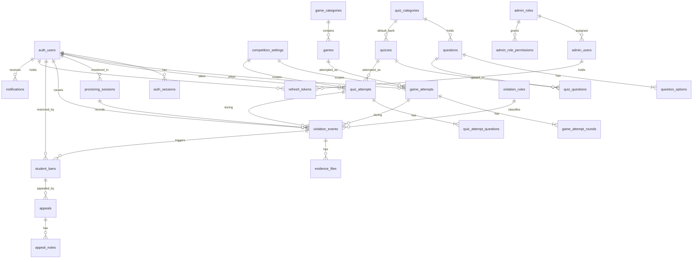

# Database

PostgreSQL only. Schema is owned by EF Core migrations in `Backend/HemCompetition.API/Data/Migrations`.

## Tables

**Kept from the original database (data preserved)**

| Table | Notes |
|---|---|
| `auth_users` | Students. `user_id` (bigint, unique) is the id every other table references. |
| `auth_sessions` | One live session per student. |
| `competition_security` | Per-student consent record (version, accepted at). Old `DISQUALIFIED` rows were copied into `student_bans`. |
| `competition_settings` | Competitions. New columns: `description`, `show_results_to_students`, `show_leaderboard`, `proctoring_required`. |
| `admin_users` | New columns: `email`, `role_id`, `lockout_end_utc`, `must_change_password`. |
| `ExceptionLogs` | Unhandled exception log. |
| `auth_users_import` | Not used by the application; left untouched. |

**New**

| Area | Tables |
|---|---|
| Access | `admin_roles`, `admin_role_permissions`, `refresh_tokens` |
| Catalogue | `game_categories`, `games`, `word_bank` |
| Game play | `game_attempts`, `game_attempt_rounds` |
| Quiz content | `quiz_categories`, `questions`, `question_options`, `quizzes`, `quiz_questions` |
| Quiz play | `quiz_attempts`, `quiz_attempt_questions` |
| Proctoring | `proctoring_sessions`, `violation_rules`, `violation_events`, `evidence_files` |
| Restrictions | `student_bans`, `appeals`, `appeal_notes` |
| Platform | `notifications`, `notification_reads`, `audit_logs`, `system_settings` |

Suggested entities that were deliberately **not** created, and why:

| Suggested | Decision |
|---|---|
| StudentProfiles | Profile columns already live on `auth_users`; a second table would only add a join. |
| Permissions / UserRoles | Permissions are a fixed catalogue in code; an admin has one role (`admin_users.role_id`). |
| QuizAnswers, GameAttemptDetails | Answers live on `quiz_attempt_questions` / `game_attempt_rounds` (one row per question/round). |
| GameResults, StudentScores, Leaderboards | Derived from attempts on demand; storing them would allow drift. |
| CompetitionGames | Games and quizzes are enabled globally (active / published flags). |
| QuestionMedia | One optional image per question: `questions.image_key` + content type. |

## ER diagram



## Integrity rules worth knowing

| Rule | Mechanism |
|---|---|
| One attempt per student, game/quiz and competition | unique index on `(competition_id, student_id, game_id)` / `(…, quiz_id)` |
| One round per number in an attempt | unique `(attempt_id, round_no)` / `(attempt_id, order_no)` |
| Exactly one correct option | partial unique index `ux_question_options_one_correct` + API validation |
| One pending appeal per ban | partial unique index `ux_appeals_one_pending` |
| A decided appeal has a reason | check constraint `ck_appeals_decision` |
| A refresh token belongs to a student or an admin, not both | check constraint |
| Sensible ranges (rounds, duration, marks, thresholds, file size) | check constraints |
| No double submission | row lock on the attempt inside a transaction |

JSONB is used only for generated puzzles/solutions/submissions, quiz question snapshots, game
options, violation details and audit details. Everything relational is relational.
Images and videos are files; the database stores key, type, size, SHA-256 and retention date.
Questions and quizzes are soft-deleted (`is_deleted`) so history stays intact.

## Migrations

| Migration | Content |
|---|---|
| `Baseline` | The six original tables exactly as the old code mapped them. |
| `PlatformSchema` | Everything new, the new columns, and the one-off data carry-over. |

`DatabaseInitializer` runs at start-up:

* empty database → runs both migrations;
* database with all six original tables and no migration history → records `Baseline` as applied
  (does **not** run it), then runs `PlatformSchema`;
* only some of the original tables, or duplicate `auth_users.user_id` values → stops with a clear
  message instead of guessing.

Create a new migration after changing entities:

```bash
cd Backend/HemCompetition.API
dotnet ef migrations add <Name> -o Data/Migrations
```
